# App guide: browsing and editing the AI KB

This repo ships two small web apps over the same Markdown files:

| App | Command | Port | Can edit? | Needs install? |
|---|---|---|---|---|
| [Edit web app](#part-1-the-edit-web-app) | `python3 webapp/server.py` | 8773 | yes | no (Python stdlib only) |
| [Read-only Django site](#part-2-the-read-only-django-site) | `python manage.py runserver 127.0.0.1:8001` | any you choose | no | `pip install -r requirements.txt` |

Both read the files on disk on every request, so what you see is always the
current state of your checkout. Neither has a database, and neither commits
anything: use git for that.

**Who it is for.** The edit app is for the person maintaining the KB on their
own machine: read a topic, fix it, rebuild the index, commit. The Django site
is a cleaner reading view (topic titles, tag and category filters, backlinks)
for browsing the base or showing it to someone.

Contents

- [Part 1: the edit web app](#part-1-the-edit-web-app)
  - [Start the app](#start-the-app)
  - [File tree and filter](#file-tree-and-filter)
  - [Reading a file](#reading-a-file)
  - [Backlinks](#backlinks)
  - [Full-text search](#full-text-search)
  - [Editing with live preview](#editing-with-live-preview)
  - [Saving](#saving)
  - [Conflicts](#conflicts)
  - [Creating a file](#creating-a-file)
  - [Deleting a file](#deleting-a-file)
  - [Reviewing changes](#reviewing-changes)
  - [Header actions](#header-actions)
  - [Glossary, learning paths, INDEX.md and llms.txt](#glossary-learning-paths-indexmd-and-llmstxt)
  - [Sidebar and small screens](#sidebar-and-small-screens)
  - [Theme](#theme)
  - [Keyboard shortcuts](#keyboard-shortcuts)
  - [Safety model](#safety-model)
  - [Configuration](#configuration)
  - [Refreshing these screenshots](#refreshing-these-screenshots)
  - [Tips, troubleshooting and limits](#tips-troubleshooting-and-limits)
- [Part 2: the read-only Django site](#part-2-the-read-only-django-site)
  - [Start it](#start-it)
  - [Topic list](#topic-list)
  - [Search](#search)
  - [Category filter](#category-filter)
  - [Topic page](#topic-page)
  - [Tag filter](#tag-filter)
  - [Links between topics](#links-between-topics)
  - [Sources and backlinks](#sources-and-backlinks)
  - [Glossary, learning paths, INDEX.md and llms.txt](#glossary-learning-paths-indexmd-and-llmstxt-1)
  - [What the site does not show](#what-the-site-does-not-show)
  - [Tips, troubleshooting and limits](#tips-troubleshooting-and-limits-1)

---

## Part 1: the edit web app

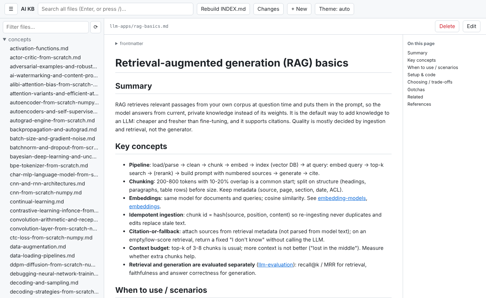

A single-file Python server (`webapp/server.py`) plus a plain HTML/JS page (`webapp/index.html`, `app.js`,
`app.css`). It lists the repo's text files, renders Markdown, searches every file, and saves your edits
straight back to disk. The same app ships with the sibling knowledge bases.

### Start the app

Requirements: Python 3. The server uses only the standard library, so there is nothing to install.

```bash
python3 webapp/server.py            # serves http://localhost:8773/
python3 webapp/server.py --open     # same, and opens your browser
python3 webapp/server.py --port 9000
```

The terminal prints `AI KB -> http://localhost:8773/  (Ctrl+C to stop)`. The default port comes from
`webapp/config.json`. Stop the server with Ctrl+C.

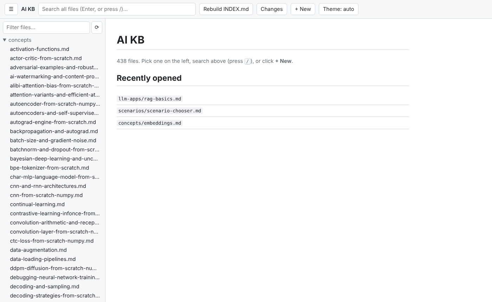

**Start page.** Shows how many files the app lists, the files you opened most recently in this browser
(up to 8, kept in the browser's local storage) and, inside a git checkout, how many files differ from the
last commit with a link to [review them](#reviewing-changes). Click the title at the top left to come back
to it.

### File tree and filter


**What it does.** The left sidebar lists every viewable file as a folder tree. Folders start collapsed; the
folders of the file you open expand automatically and that file is highlighted.

**How to use it.**
1. Click a folder to expand it, then click a file to open it.
2. Type in **Filter files...** to keep only files whose path contains the text (case-insensitive, here
   `rag`). All matching folders open. Clear the box to see the full tree again.
3. Click **⟳** to reload the tree after you add, rename or delete files outside the app.

**Which files appear.** Files ending in `.md`, `.txt`, `.csv`, `.json`, `.yml`, `.yaml`, `.toml`, `.py`, `.sh`. Hidden files and folders (names starting with `.`),
symlinks and the folders `node_modules`, `__pycache__`, `venv`, `.venv` are left out.

### Reading a file


**What it does.** The selected file is shown on the right; the bar above it shows its path.

- `.md` files are rendered: headings, paragraphs, bold/italic/strikethrough, inline code, fenced code
  blocks, block quotes, horizontal rules, nested lists, task lists (shown as ☐/☑) and tables.
- `.csv` files are shown as a table; everything else as plain text.
- The address bar changes to `#/<path>` (for example `http://localhost:8773/#/llm-apps/rag-basics.md`), so you can
  bookmark a file and use the browser's Back and Forward buttons.

**Outline.** A Markdown file with three or more headings gets an **On this page** list on the right (on
windows wider than 1100 px). Click an entry to jump to that section; the section flashes yellow.

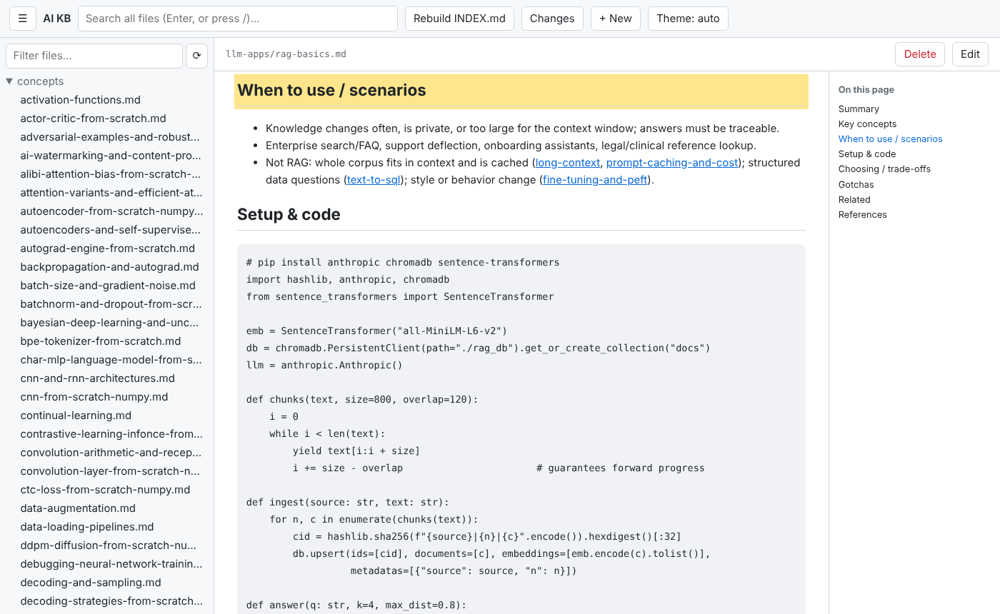

**Links.**
- Relative links such as `[x](../folder/topic.md)` open the target in the app. Links to a heading,
  `[x](topic.md#defenses)` or `[x](#defenses)`, jump to it: every heading gets a GitHub-style id (lower
  case, punctuation dropped, spaces as hyphens).
- `[[wiki-links]]` resolve by full path without `.md` first, then by file name alone. `[[name|text]]` shows
  `text`, and `[[name#heading]]` jumps to a heading. A wiki-link with no matching file is grey (hover text
  "missing"), so broken links are easy to spot.
- External links (`http`, `https`, `mailto`) open in a new tab.
- Images (``) are shown for PNG, JPEG, GIF and WebP files inside the repo. Remote
  images become links, because the page loads images only from the app itself. SVG is not shown.

**Frontmatter.** A `---` block at the top of a Markdown file is hidden behind a collapsed **frontmatter**
line. Click it to see the raw YAML.


### Backlinks

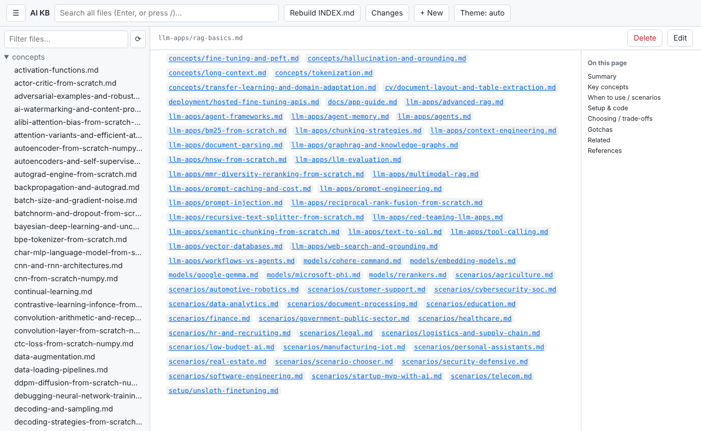

**What it does.** Below every Markdown file the app lists the other files that link to it, by
`[[wiki-link]]` or relative link. Each entry opens that file at the line holding the link. "No other file
links here" marks an orphan that readers following links can never reach: link it from a related topic.

### Full-text search


**How to use it.**
1. Click the search box (or press **/** anywhere outside a text field) and type at least 2 characters.
2. Press **Enter**. The address bar changes to `#search=<text>`, so Back returns to the results.
3. Each result shows `path:line` and the matching line with the match highlighted; a file whose name
   matches is listed as `(filename)`. Click a result to open the file at that line: the view scrolls to the
   block holding it and flashes it, and **Edit** puts the cursor on that line.

**Details.** Matching is a case-insensitive plain substring, not a regular expression. At most 200 results
are returned; files over 2 MB or not valid UTF-8 are skipped.

### Editing with live preview

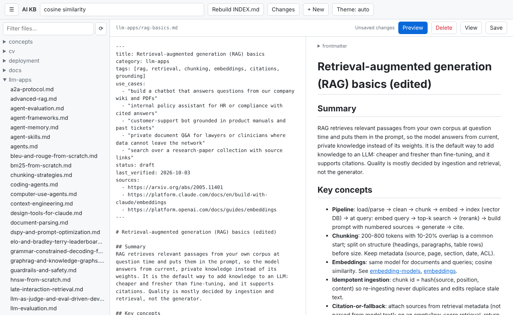

**How to use it.**
1. Open a file and click **Edit**. The rendered view is replaced by a plain-text editor, and **Save**
   and **Preview** appear. The button now reads **View**.
2. Click **Preview** (Markdown and CSV files) to show the rendered result beside the editor. It updates as
   you type; click again to hide it. The setting lasts until you reload the page.
3. Click **View** to see the rendered text, saved or not. Unsaved edits stay; the status still reads
   **Unsaved changes**.

On a window 700 px wide or less the preview is hidden; use **View** instead.

### Saving

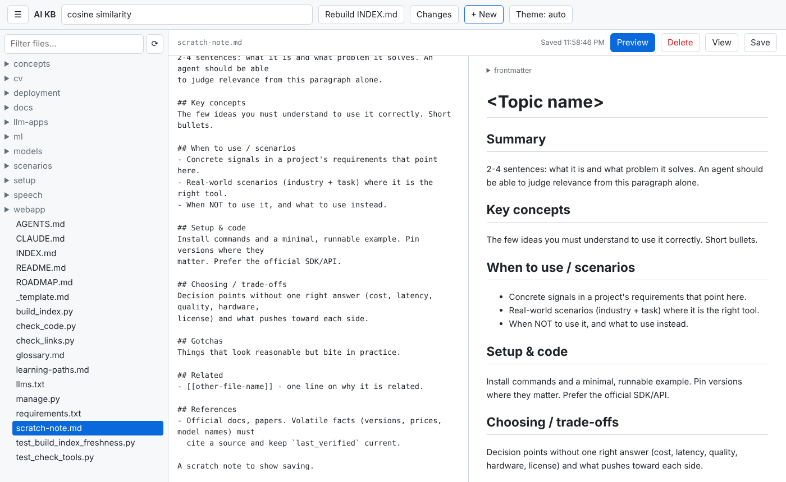

Save with **Ctrl+S** (**Cmd+S** on macOS) or the **Save** button. The status shows **Saved** and the time.
If you try to leave the file with unsaved changes, the app asks "Discard unsaved changes?"; closing or
reloading the tab triggers the browser's leave-page warning.

**What happens on disk.** Line endings become LF, the text is written as UTF-8, and the file is replaced in
one step (temporary file, then rename), keeping its permissions. Nothing is committed: review your edits on
the [Changes](#reviewing-changes) page or with `git diff`, then commit with git.

### Conflicts


**What it does.** The app remembers each file's modification time when it opens it. If the file changed on
disk before you save (another editor, `git pull`, a second browser tab), the save is refused, nothing is
written, and the bar shows **file changed on disk since you opened it** with two buttons:

- **Load disk version** drops your edits and opens the file as it is on disk now.
- **Overwrite** saves your text over the newer file (after a confirmation). Use it only when you know the
  other change can go; otherwise copy your text out first, load the disk version and re-apply your edit.

### Creating a file


1. Click **+ New** in the header.
2. Enter a repo-relative path, for example `folder/new-topic.md`.
3. The file is created (missing folders too), appears in the tree and opens in the editor.

A new `.md` file starts as a copy of `_template.md`, with `YYYY-MM-DD` set to today and, where the template
has a `category: <...>` line, the category set to the first folder of the path. Fill in every section, then
run the repo's checks. Other file types start empty.

**Rules.** The path must end in one of the listed extensions and may not contain hidden (`.`) parts, `..`
or skipped folders. An existing file is never overwritten ("already exists").

### Deleting a file

Open the file and click **Delete** in the bar, then confirm. The file is removed from disk and the app goes
back to the start page. A file that was committed can be restored with `git restore <path>`; a file that was
never committed cannot be recovered. Read-only files have no **Delete** button, and a file that changed on
disk since you opened it is not deleted.

### Reviewing changes

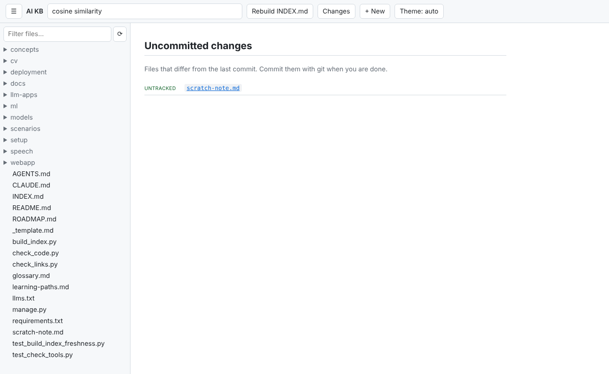

**What it does.** Inside a git checkout the header has a **Changes** button. It lists every file that
differs from the last commit (`git status`), marked modified, added, deleted, renamed or untracked.

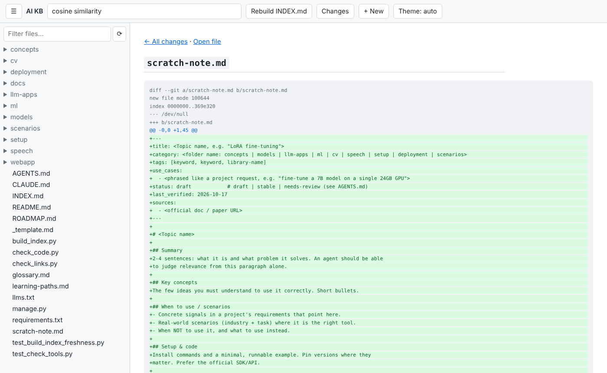

Click a file to see its diff against the last commit: added lines in green, removed lines in red. **Open
file** jumps to the file, **All changes** goes back. Use it before you commit to check what you edited in the
app. Only the file types the tree shows are linked; diffs over 256 KB are cut. The page is read-only: stage
and commit with git.

### Header actions

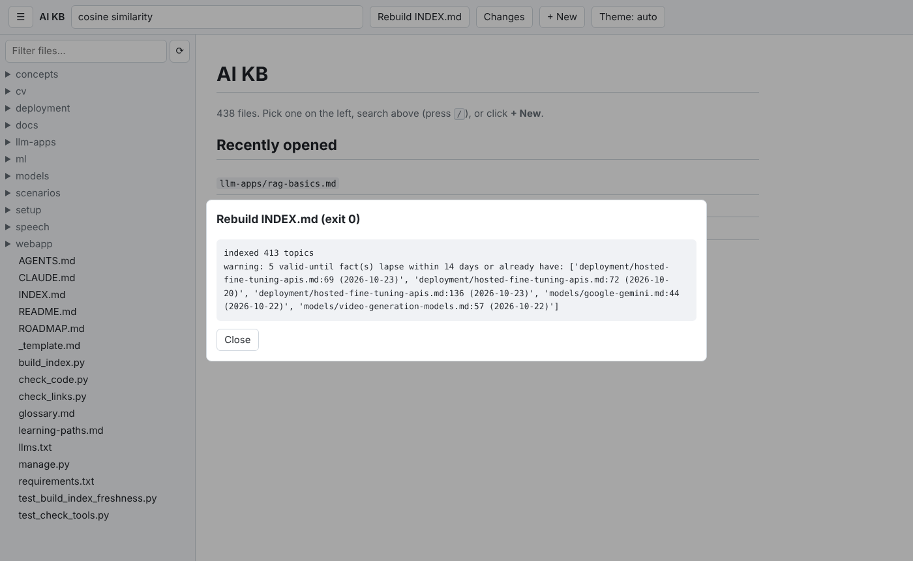

- **Rebuild INDEX.md** runs `python3 build_index.py`.

Click a button to run its command in the repo root (2-minute limit). A window shows the exit code and the
last 4000 characters of output; close it with **Close** or Esc. The tree reloads afterwards, and the open file
reloads if it has no unsaved edits, so regenerated files show their new content.

**Rebuild INDEX.md** runs `python3 build_index.py` with the same Python that runs the server. Use it after you add a topic or change any frontmatter (`title`, `tags`, `use_cases`, `status`, `last_verified`): `INDEX.md` and `llms.txt` are generated, never edited by hand. A non-zero exit means missing frontmatter or a broken `[[link]]`, and the output names the file; it also prints orphan, staleness and `valid-until` warnings. CI runs `python build_index.py --strict`, which also fails on orphan topics and overview topics no scenario links to, so run that in a terminal before you push.

### Glossary, learning paths, INDEX.md and llms.txt

These four repo-root files are entry points, not topics. In the tree they sit below the folders, and search
finds them like any other file.


**glossary.md** renders as letter sections of `**Term** - definition. [[topic]]` lines; each `[[topic]]` opens
the topic. The outline on the right lists the letters, so click one to jump there.


**learning-paths.md** renders as numbered reading lists by role (beginner, LLM engineer, agent builder, ...).
Click each step in order.


**INDEX.md** renders as one table per category (Topic, Tags, Use when, Status, Verified); the topic links
open the file, and the category links at the top jump to their table. Hide the sidebar to give the table
more room. **llms.txt** is shown as plain text.

`build_index.py` checks glossary.md and learning-paths.md: a broken `[[link]]` in them fails the build. Edit
them in the app like any other file. Do not edit INDEX.md or llms.txt: change the topic and press
**Rebuild INDEX.md**.

### Sidebar and small screens


Click **☰** to hide or show the sidebar and give wide tables the full width.

On a window 700 px wide or less the sidebar opens over the page: the app starts with it closed, and it
closes again when you pick a file. The header wraps and the search box takes its own row.

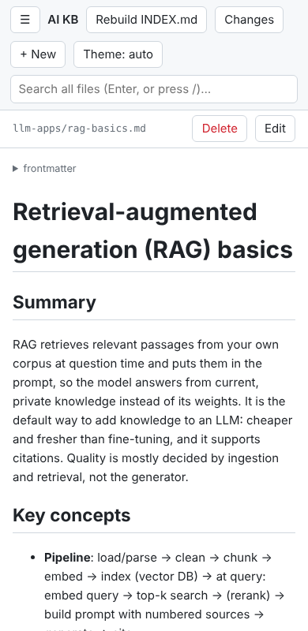 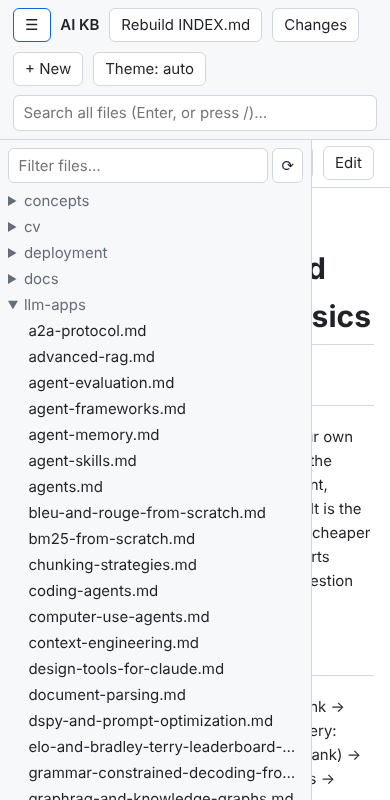

### Theme


The **Theme** button cycles through **auto** (follow the operating system or browser setting), **light** and
**dark**. The choice is kept in this browser.

### Keyboard shortcuts

| Key | Does |
|---|---|
| **/** | Focus the search box (outside text fields) |
| **Enter** in the search box | Search |
| **Ctrl+S** / **Cmd+S** | Save |
| **Esc** | Close the action output window |

### Safety model

The app can write to your repository, so it is locked down to your own machine:

- **Local only.** The server listens on `127.0.0.1`; other machines cannot reach it.
- **Host and Origin checks.** Requests whose `Host` is not `localhost`, `127.0.0.1` or `::1` are refused with
  "forbidden host" (this blocks DNS-rebinding attacks from web pages); so is a request whose `Origin` does
  not match the host.
- **Write token.** Every start generates a random token. The page fetches it on load and sends it with each
  save, create, delete and action; without it, writes are refused with "bad token (reload the page)".
- **Path limits.** Only files with the listed extensions, inside the repo, outside hidden and skipped
  folders, can be read, written or deleted. Paths with `..`, absolute paths and backslashes are rejected.
  Files over 2 MB cannot be opened or saved here.
- **Read-only routes.** Images (PNG, JPEG, GIF, WebP up to 10 MB, checked by extension and content),
  backlinks, the change list and diffs only read. Git runs with fixed arguments, never a shell.
- **Browser hardening.** Responses carry a strict Content-Security-Policy (only the app's own script and
  stylesheet), `X-Content-Type-Options: nosniff`, `Referrer-Policy: no-referrer` and `Cache-Control:
  no-store`. Markdown is rendered with raw HTML escaped, so a file cannot inject script into the page.
- **Conflict checks** stop a save or delete from overwriting a newer file.

### Configuration

`webapp/config.json`:

| Key | Meaning |
|---|---|
| `title`, `port` | Page title and default port |
| `extensions`, `skip_dirs` | Which files the tree lists and which folders it skips |
| `readonly` | Paths shown with 🔒 that cannot be saved, deleted or created under, e.g. `["generated/", "INDEX.md"]` |
| `template` | File a new `.md` file starts from (here `_template.md`) |
| `actions` | Header buttons: `{"Name": ["command", "arg"]}`, run in the repo root |
| `screenshots` | Settings for `webapp/screenshots.mjs` (below) |

Restart the server after changing it.

### Refreshing these screenshots

The screenshots in this guide come from the real app. To regenerate them after a change, commit your work
first (the Changes shots list every uncommitted file), then:

```bash
npm install -g playwright && npx playwright install chromium   # once
node webapp/screenshots.mjs                                     # writes docs/screenshots/webapp-*.png
SHOTS_OUT=/tmp/shots node webapp/screenshots.mjs                # trial run elsewhere
```

It starts the server on a free port, opens `llm-apps/rag-basics.md` and the other pages named under `screenshots` in
`config.json`, creates and deletes a scratch file `scratch-note.md`, and runs the first header action.

### Tips, troubleshooting and limits

- **"bad token (reload the page)"**: the server was restarted since the page loaded. Reload the page.
- **"forbidden host"**: open the app as `http://localhost:8773/` or `http://127.0.0.1:8773/`.
- **Address already in use**: another program uses the port. Start with `--port <other>`.
- **A file is missing from the tree**: check its extension and folder (see
  [File tree and filter](#file-tree-and-filter)), then click **⟳**.
- **No Changes button**: the folder is not a git checkout, or `git` is not installed.
- **No rename.** Rename with git (`git mv`) or your file manager, then click **⟳**.
- Backlinks and search read every file on each request; on a very large repo they take a moment.

---

## Part 2: the read-only Django site


A small Django project (`manage.py`, `webapp/settings.py`, `webapp/urls.py`,
`webapp/views.py`, `webapp/templates/`) that shows the topics as a site:
titles instead of file names, category and tag filters, rendered pages with
working `[[links]]`, and a "Linked from" list. It also shows the glossary, learning
paths, INDEX.md and llms.txt. It cannot change any file.

### Start it

```bash
pip install -r requirements.txt               # django, markdown
python manage.py runserver 127.0.0.1:8001     # http://127.0.0.1:8001/
python manage.py test webapp                  # its tests (and the edit app's write tests)
```

Without an address `runserver` uses port 8000; any free port works.

Settings come from environment variables (`webapp/settings.py`):

| Variable | Default | Purpose |
|---|---|---|
| `DJANGO_DEBUG` | `1` | `0` turns off debug pages |
| `DJANGO_SECRET_KEY` | a fixed dev value | set a real one if you expose the site |
| `DJANGO_ALLOWED_HOSTS` | `localhost,127.0.0.1` | comma-separated host names it answers to |

There is no database and no migrations to run, and all CSS is inline in
`base.html`, so there are no static files to collect.

### Topic list

**What it does.** The home page (`/`) lists every topic grouped by category
(folder), alphabetically. Each entry shows the topic's `title` from its
frontmatter, its `status` (draft/stable/needs-review) and its first
`use_cases` line, so you can tell what a topic is for without opening it. A
line above the list says how many topics are shown out of the total.

**When.** Scanning what the KB covers, or finding a topic by what you want to
do (the use-case line) rather than by its file name.

**Why.** INDEX.md holds the same data, but as one long table; this view is
grouped, shorter per entry, and filterable.

### Search


**What it does.** The header box searches the full text of every topic,
frontmatter included. Every word you type must appear somewhere in the topic
(in any order, case-insensitive, partial words count): `kv cache` matches
topics containing both "kv" and "cache". Results keep the grouped list
format.

**How to use it.** Type in **Search topics** and press Enter. The query is in
the URL (`/?q=kv+cache`), so a search can be bookmarked or shared.

**When.** "Which topics deal with X?" when you want topics, not lines (the
edit app's search shows lines).

**Why.** Word-based matching finds topics that mention all your terms even
when they are not next to each other.

### Category filter


**What it does.** The chips under the header (**all (413)**, **concepts
(123)**, ...) limit the list to one category. The counts are each category's
total size. The selected chip is highlighted.

**How to use it.** Click a chip; click **all** to remove the filter. A category
filter combines with a search: search first, then click a chip, and the query
is kept (`/?category=models&q=pricing`).

**When.** Browse only `scenarios/` (problem-to-approach guides) or only
`models/`.

### Topic page


**What it does.** `/t/<file-name>/` (for example `/t/rag-basics/`) shows one
topic:

- a line with the category (a link to that category's list), `status`,
  `last_verified` date and the file path;
- the topic's `tags` as chips;
- the body rendered with Python-Markdown (fenced code, tables, lists); the
  frontmatter itself is not shown as text.

**When.** Reading a topic. The verified date on top tells you how fresh its
volatile facts (model names, prices, limits) are.

### Tag filter


**What it does.** Clicking a tag chip on a topic page lists every topic with
that tag (`/?tag=chunking`). The line above the list says "tagged
**chunking** (clear)"; **clear** removes the tag filter.

**When.** Finding siblings of a topic: everything else tagged `rag`,
`fine-tuning`, `from-scratch`, and so on.

**Why.** Tags cut across folders, so they find related topics that live in
different categories.

Note: clicking a category chip while a tag filter is on drops the tag filter.

### Links between topics

![Related section on the site: [[links]] shown with the target topic's title](screenshots/django-links.png)

**What it does.**

- `[[name]]`, `[[name|label]]` and `[[name#section]]` become links to
  `/t/name/`. Without a label the link text is the target's title, so you see
  "Chunking strategies for RAG (...)" instead of `chunking-strategies`.
- A `[[name]]` that matches no topic is shown in red with a strikethrough.
- Relative Markdown links to another topic (`[x](../concepts/embeddings.md#key-concepts)`)
  are rewritten to the site page, keeping the `#section`.
- Links to `glossary.md`, `learning-paths.md`, `INDEX.md` and `llms.txt` go to
  `/glossary/`, `/learning-paths/`, `/index/` and `/llms.txt`.
- Text inside code blocks and inline code is left alone, so `[[1, 2]]` in a
  Python snippet stays a list.

Links match on the file name only (`rag-basics`), so two topics with the same
file name in different folders would clash; the build keeps names unique.

### Sources and backlinks


**What it does.** Below the body:

- **Sources** lists the URLs from the topic's `sources` frontmatter as links.
- **Linked from** lists every topic whose text contains `[[this-topic]]`,
  sorted by title. Links written with a label or section
  (`[[rag-basics|RAG]]`, `[[rag-basics#gotchas]]`) and plain Markdown links
  are not counted.

**When.** Backlinks show where a topic is used, which helps you judge its
reach before you change it, and lead you to the scenario and overview pages
that point at it. Sources tell you where to re-check a fact.

**Why.** Neither GitHub nor the edit app can show "what links here".

### Glossary, learning paths, INDEX.md and llms.txt


**What it does.** The header links to four read-only pages besides the topics:
**Glossary** (`/glossary/`, glossary.md), **Learning paths** (`/learning-paths/`,
learning-paths.md), **INDEX.md** (`/index/`) and **llms.txt** (`/llms.txt`, served
as plain text). The three Markdown files are rendered like topics: their `[[links]]`
and relative links (INDEX.md's `scenarios/agriculture.md` rows) open the topic pages.
A topic's Markdown link to one of these files (`[terms](../glossary.md#a)`) opens
the matching page, keeping the `#section`.

**When.** Looking up a term and jumping to the topic that explains it, or following
a reading path step by step.

### What the site does not show

The site serves topics plus only those four files, from a fixed list. Other
repo-root files (README.md, AGENTS.md, ROADMAP.md, `_template.md`) have no page,
and a link to one of them leads to a "Page not found". Read those in the
[edit app](#glossary-learning-paths-indexmd-and-llmstxt) or on GitHub.

### Tips, troubleshooting and limits

- **Edits show up on refresh.** Every request re-reads the files, so you can
  edit in the edit app or your editor and reload the site page.
- **"Bad Request (400)"**: you opened the site under a host name that is not in
  `DJANGO_ALLOWED_HOSTS` (for example `localhost` vs a LAN IP). Add it to the
  variable.
- **Port in use**: other tools may use 8000; pass another port such as
  `127.0.0.1:8001`.
- **`ModuleNotFoundError: No module named 'django'` or `'markdown'`**: run
  `pip install -r requirements.txt` in the Python you start it with.
- Limits: read-only; no ranking of search results; it re-reads all 400+ files
  on each request, which is fine locally but not tuned for heavy traffic;
  `runserver` is Django's development server, not a production server.
