# App guide: browsing and editing the AI KB

This repo ships two small web apps over the same Markdown files:

| App | Command | Port | Can edit? | Needs install? |
|---|---|---|---|---|
| [Edit web app](#part-1-the-edit-web-app) | `python3 webapp/server.py` | 8773 | yes | no (Python stdlib only) |
| [Read-only Django site](#part-2-the-read-only-django-site) | `python manage.py runserver 127.0.0.1:8001` | any you choose | no | `pip install -r requirements.txt` |

Both read the files on disk on every request, so what you see is always the
current state of your checkout. Neither has a database, and neither commits
anything: use git for that.

**Who it is for.** The edit app is for the person maintaining the KB on their
own machine: read a topic, fix it, rebuild the index, commit. The Django site
is a cleaner reading view (topic titles, tag and category filters, backlinks)
for browsing the base or showing it to someone.

Contents

- [Part 1: the edit web app](#part-1-the-edit-web-app)
  - [Start it](#start-it)
  - [Layout](#layout)
  - [File tree and filter](#file-tree-and-filter)
  - [Rendered Markdown and wiki-links](#rendered-markdown-and-wiki-links)
  - [Frontmatter toggle](#frontmatter-toggle)
  - [Full-text search](#full-text-search)
  - [Edit mode](#edit-mode)
  - [Save (button or Ctrl+S)](#save-button-or-ctrls)
  - [+ New file](#-new-file)
  - [Rebuild INDEX.md](#rebuild-indexmd)
  - [Conflict detection](#conflict-detection)
  - [Sidebar toggle](#sidebar-toggle)
  - [Glossary, learning paths, INDEX.md and llms.txt](#glossary-learning-paths-indexmd-and-llmstxt)
  - [Dark mode](#dark-mode)
  - [Safety model](#safety-model)
  - [Settings (webapp/config.json)](#settings-webappconfigjson)
  - [Tips, troubleshooting and limits](#tips-troubleshooting-and-limits)
- [Part 2: the read-only Django site](#part-2-the-read-only-django-site)
  - [Start it](#start-it-1)
  - [Topic list](#topic-list)
  - [Search](#search)
  - [Category filter](#category-filter)
  - [Topic page](#topic-page)
  - [Tag filter](#tag-filter)
  - [Links between topics](#links-between-topics)
  - [Sources and backlinks](#sources-and-backlinks)
  - [Glossary, learning paths, INDEX.md and llms.txt](#glossary-learning-paths-indexmd-and-llmstxt-1)
  - [What the site does not show](#what-the-site-does-not-show)
  - [Tips, troubleshooting and limits](#tips-troubleshooting-and-limits-1)

---

## Part 1: the edit web app

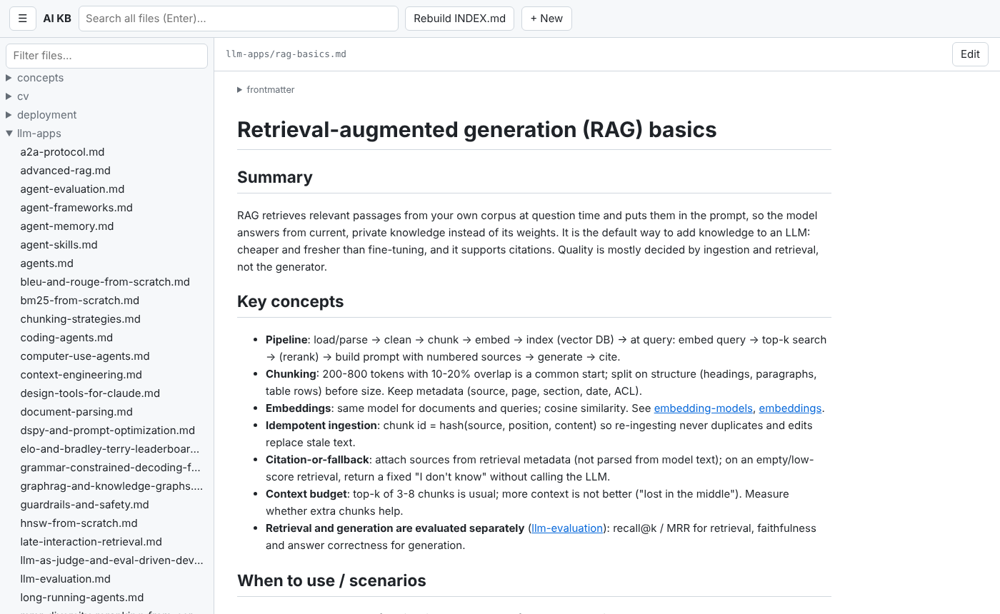

A single-file Python server (`webapp/server.py`) plus a plain HTML/JS page
(`webapp/index.html`, `app.js`, `app.css`). It lists the repo's text files,
renders Markdown, searches every file, and saves your edits straight back to
disk.

### Start it

```bash
python3 webapp/server.py            # prints: AI KB -> http://localhost:8773/
python3 webapp/server.py --open     # same, and opens your browser
python3 webapp/server.py --port 9000
```

- Requirements: Python 3 only. No `pip install`.
- Default port 8773 comes from `webapp/config.json`; `--port` overrides it.
- It listens on `127.0.0.1` only. Open `http://localhost:8773/` or
  `http://127.0.0.1:8773/`; other host names are refused (see
  [Safety model](#safety-model)).
- Stop it with Ctrl+C.

### Layout

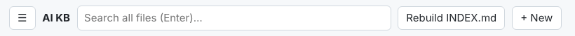

- **Header**, left to right: sidebar toggle (☰), the title, the search box,
  one button per configured action (**Rebuild INDEX.md**), and **+ New**.
- **Sidebar**: a filter box and the file tree.
- **Main pane**: a bar with the open file's path, a status message and the
  **Edit/View** and **Save** buttons; below it the rendered file or the editor.

The open file is part of the URL (`http://localhost:8773/#/llm-apps/rag-basics.md`),
so you can bookmark a topic, and the browser's Back button returns to the
previous file.

### File tree and filter

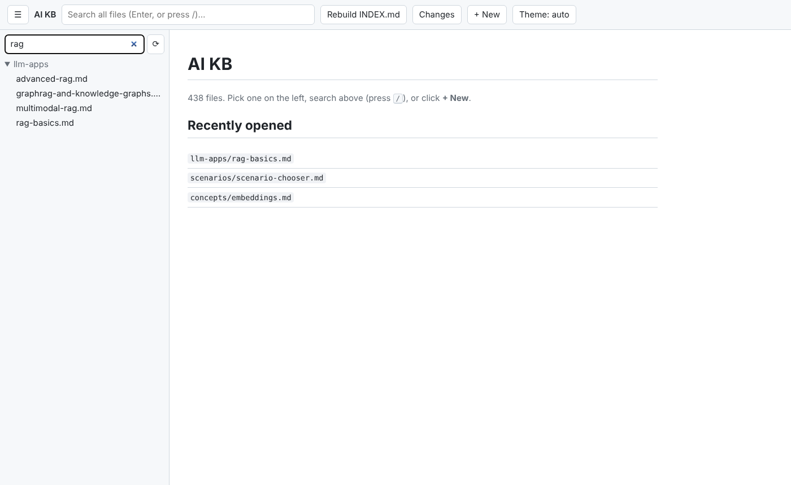

**What it does.** The tree shows every file under the repo with one of these
extensions: `.md .txt .csv .json .yml .yaml .toml .py .sh`. Folders start
collapsed; repo-root files (README, INDEX.md, glossary.md, ...) are listed
after the folders. The open file is highlighted and its folders expand.
Hidden files and folders (names starting with `.`), `node_modules`,
`__pycache__`, `venv`, `.venv` and symlinks are left out.

**How to use it.** Click a folder to expand it, click a file to open it. Type
in **Filter files…** to keep only files whose path contains the text (case
does not matter); all matching folders expand. Clear the box to get the full
tree back.

**When.** Jump to a topic whose name you roughly know, or see every file in
one category. Filtering on a folder name such as `scenarios/` lists that
category.

**Why.** 400+ topics in nine folders are too many to scroll; the filter is
instant and needs no server round trip.

### Rendered Markdown and wiki-links

![The Related section of rag-basics with [[wiki-links]] rendered as links](screenshots/webapp-wiki-links.png)

**What it does.** `.md` files are rendered by a small built-in renderer:
headings, paragraphs, bold/italic/strikethrough, inline code, fenced code
blocks, block quotes, horizontal rules, nested bullet and numbered lists,
task boxes (`- [ ]` shows ☐, `- [x]` shows ☑) and tables. `.csv` files are
shown as a table; every other file type is shown as plain text.

Links:

- `[[topic]]` and `[[topic|label]]` become links. The name is matched against
  the full path first (`[[llm-apps/rag-basics]]`), then against file names, so
  `[[rag-basics]]` finds `llm-apps/rag-basics.md`. A name that matches no file
  is shown greyed out, with a "missing" tooltip.
- Relative Markdown links (`[x](../concepts/embeddings.md)`) open the target
  inside the app when the file exists.
- `http(s)://` and `mailto:` links open in a new tab.
- Links to an in-page anchor only (`[A](#a)`) are shown as plain text.
- Images (``) are shown when they are PNG, JPEG,
  GIF or WebP files inside the repo; the path is resolved against the open
  file's folder. Remote images (`https://...`) are shown as a link instead,
  because the page only loads images from the app itself. SVG is not shown.

**How to use it.** Click any link to move between topics. Follow a topic's
`## Related` list, which is how the KB is meant to be navigated.

**When.** Reading a topic and its neighbours, for example walking from
`scenarios/scenario-chooser.md` to the topics it recommends.

**Why.** GitHub and most editors show `[[wiki-links]]` as literal brackets.
Here they work, so the link graph the KB is built on is clickable.

### Frontmatter toggle

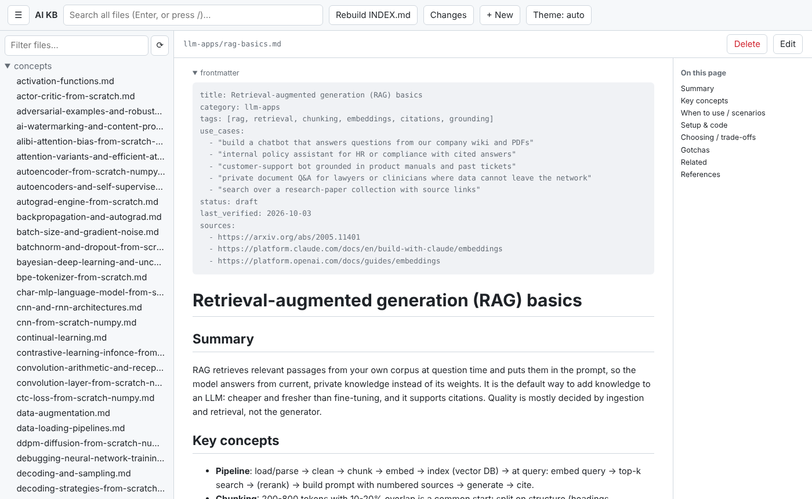

**What it does.** The YAML frontmatter at the top of a topic (`title`,
`category`, `tags`, `use_cases`, `status`, `last_verified`, `sources`) is
folded into a **▸ frontmatter** line so the page starts with the content.

**How to use it.** Click **frontmatter** to show the raw YAML; click again to
hide it. It is folded again each time you open a file.

**When.** Check a topic's `status`, its `last_verified` date (how fresh its
volatile facts are) or its source URLs.

**Why.** The metadata matters for judging a topic but is noise when reading
it.

### Full-text search

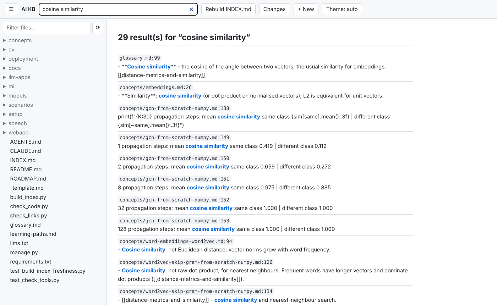

**What it does.** Searches every file in the tree (all the extensions above,
not just topics) for the text you typed, case-insensitively. The whole query
is matched as one substring: `kv cache` finds "KV cache" but not "cache for
KV". When a file's path contains the query, an extra `(filename)` hit is
listed before that file's line hits. Each hit shows `path:line` and the trimmed line, with the match
in bold. At most 200 hits are returned.

**How to use it.** Type at least 2 characters in **Search all files…** and
press **Enter**. Click a hit to open that file at that line: the view scrolls
to the block (heading, paragraph, list item, table row, code block) holding
the line and flashes it, and **Edit** puts the cursor on the line. A
`(filename)` hit opens the file at the top.

**When.** Find every topic that mentions a model, library or term; check where
a term is defined (`glossary.md` hits show up too); find stale mentions before
a rename.

**Why.** One box over the whole base, including INDEX.md, llms.txt and the
build scripts, without leaving the page or opening a terminal.

### Edit mode

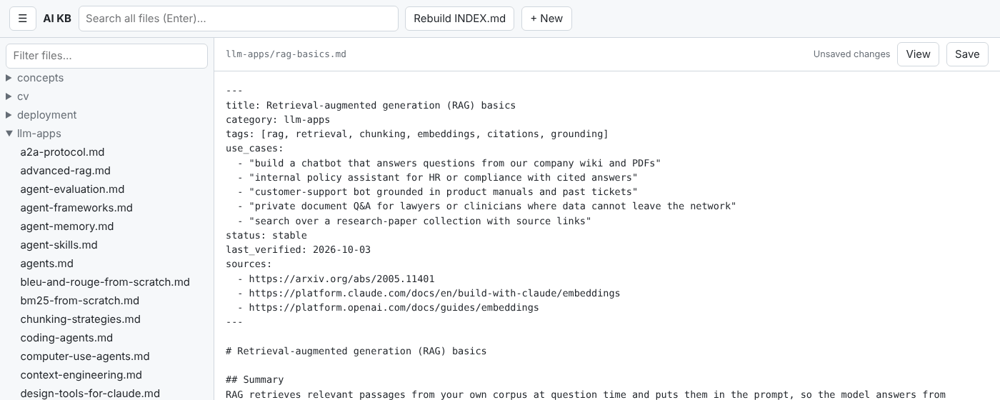

**What it does.** **Edit** swaps the rendered view for a plain-text editor
holding the raw file, frontmatter included. Typing marks the file as changed
and the bar shows **Unsaved changes**. **View** switches back; the rendered
view updates after you save.

**How to use it.**
1. Open a file and click **Edit**.
2. Change the text.
3. Save with **Save** or Ctrl+S (see below).
4. Click **View** to check the rendered result.

If you click another file, a link, or Back with unsaved changes, the app asks
"Discard unsaved changes?". Cancel keeps you on the file. Closing or reloading
the tab triggers the browser's own "leave site?" warning.

**When.** Small fixes: a wrong number, a broken link, bumping `last_verified`,
adding a Related line. For large rewrites your usual editor may be more
comfortable; the app shows the result either way.

**Why.** Fixing a topic right where you noticed the problem, with the rendered
result one click away.

### Save (button or Ctrl+S)

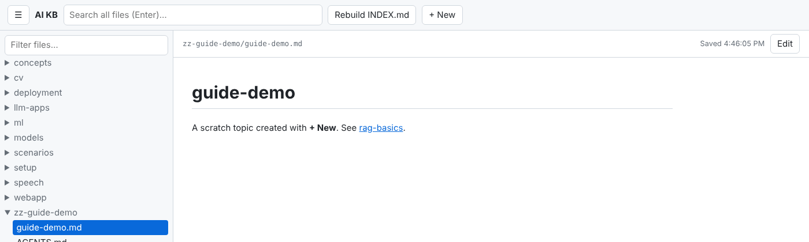

**What it does.** Writes the editor text to the file on disk. Line endings are
converted to LF, the file is written to a temp file and renamed over the
original (so a crash cannot leave half a file), and the original file
permissions are kept. The bar shows **Saved** plus the time.

**How to use it.** Click **Save** (visible in edit mode) or press Ctrl+S
(Cmd+S on macOS). The shortcut replaces the browser's "save page" dialog
while the app is open.

**Why.** Quick save without leaving the keyboard; LF endings match the repo
rule in AGENTS.md.

After saving, review and commit with git as usual. If you changed a topic's
frontmatter, run [Rebuild INDEX.md](#rebuild-indexmd).

### + New file

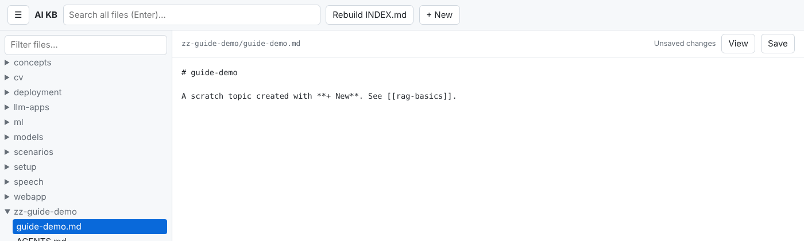

**What it does.** Creates a new file at a path you choose, adds it to the tree
and opens it in edit mode. A `.md` file starts with a `# name` heading;
other types start empty. Missing parent folders are created.

**How to use it.**
1. Click **+ New**.
2. Type a repo-relative path, for example `llm-apps/my-topic.md`, and press OK.
3. Write the content and save.

It refuses a path that already exists ("already exists"), an extension
outside the list above, absolute paths, `..`, and any path part starting
with `.`.

**When.** Starting a new topic. For a real topic, open `_template.md`, copy
its text into the new file, and fill in every section (see AGENTS.md, "Adding
or editing a topic"); the app does not copy the template for you.

**Why.** Create, write and preview a topic without leaving the browser.

### Rebuild INDEX.md

The **Rebuild INDEX.md** button in the header (see [Layout](#layout)) runs
`python3 build_index.py` in the repo root, with the same Python that runs the
server. When it finishes, a browser alert shows the exit code and the last
4,000 characters of its output, for example:

```
Rebuild INDEX.md (exit 0)

indexed 413 topics
warning: 5 valid-until fact(s) lapse within 14 days ...
```

**When.** After you add a topic or change any frontmatter (`title`, `tags`,
`use_cases`, `status`, `last_verified`). `INDEX.md` and `llms.txt` are
generated; never edit them by hand.

**Why.** It catches what the build checks: a non-zero exit code means missing
frontmatter or a broken `[[link]]`, and the output names the file. It also
prints the orphan and staleness warnings.

Note: the button runs the plain build. CI runs `python build_index.py
--strict`, which also fails on orphan topics and overview topics no scenario
links to, so run that in a terminal before you push. The build has a
120-second limit.

### Conflict detection

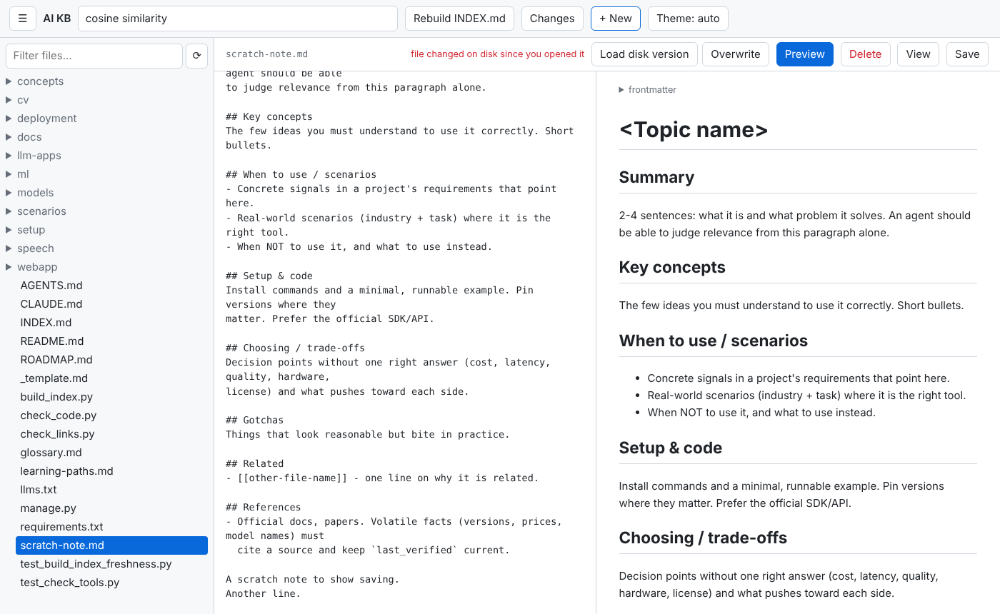

**What it does.** When you open a file the app remembers its modification
time. On save it checks again; if the file changed on disk in the meantime
(you edited it in another editor, ran `git pull`/`git checkout`, or saved it
from a second browser tab), the save is refused and the bar shows **file
changed on disk since you opened it** in red. Nothing is written.

**How to resolve it.**
1. Copy your edited text (Ctrl+A, Ctrl+C in the editor).
2. Reload the page and confirm the browser's "leave site?" warning; the same
   file opens again, now showing the version on disk.
3. Merge your change into it and save.

**Why.** Without it, a save from a stale tab would silently overwrite someone
else's (or your own) newer change.

### Sidebar toggle

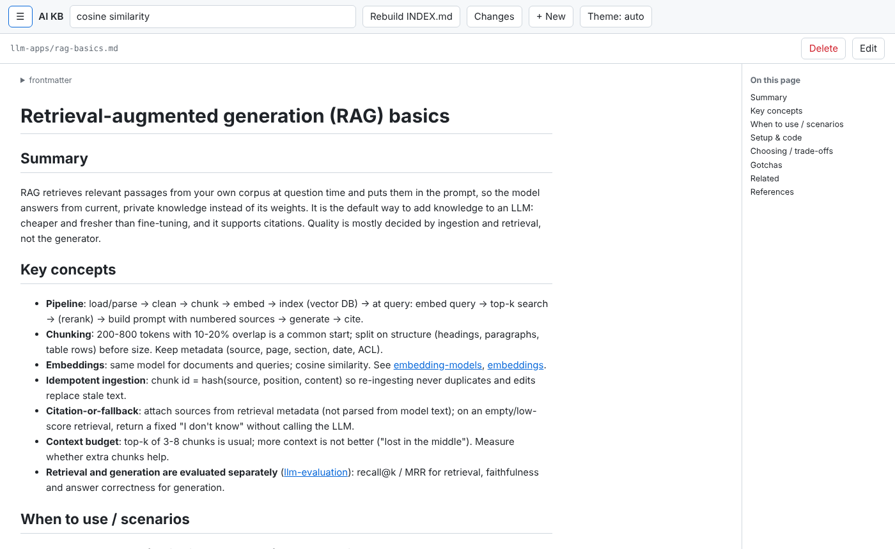

Click **☰** to hide or show the sidebar. Use it for wide tables such as the
ones in `scenarios/scenario-chooser.md` and `INDEX.md`, or on a small screen.
On screens narrower than 700 px the sidebar opens as an overlay on top of the
page instead of beside it.

### Glossary, learning paths, INDEX.md and llms.txt

These four repo-root files are entry points, not topics. In the edit app they
appear at the bottom of the tree (after the folders) and are found by search.

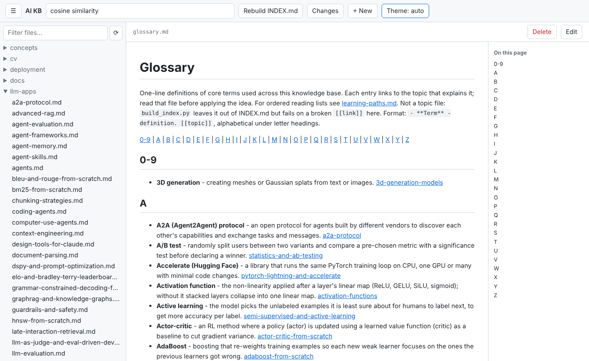

**glossary.md** renders as letter sections of `**Term** - definition. [[topic]]`
lines; each `[[topic]]` is a working link. The A-Z letter bar at the top is
plain text in the app (in-page anchors are not linked), so scroll or use
Ctrl+F to find a term.

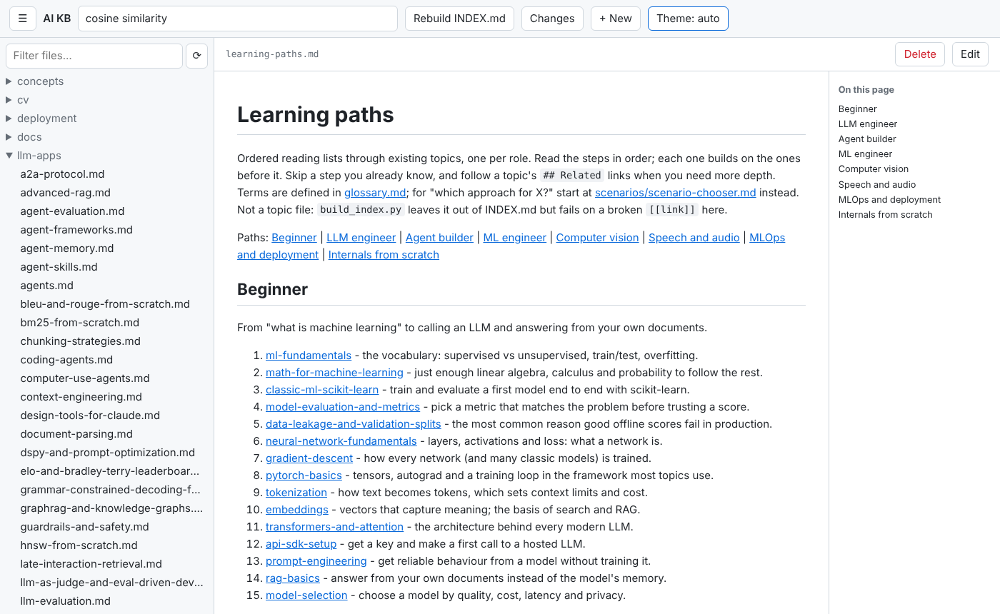

**learning-paths.md** renders as numbered reading lists by role (beginner, LLM
engineer, agent builder, ...). Click each step in order.

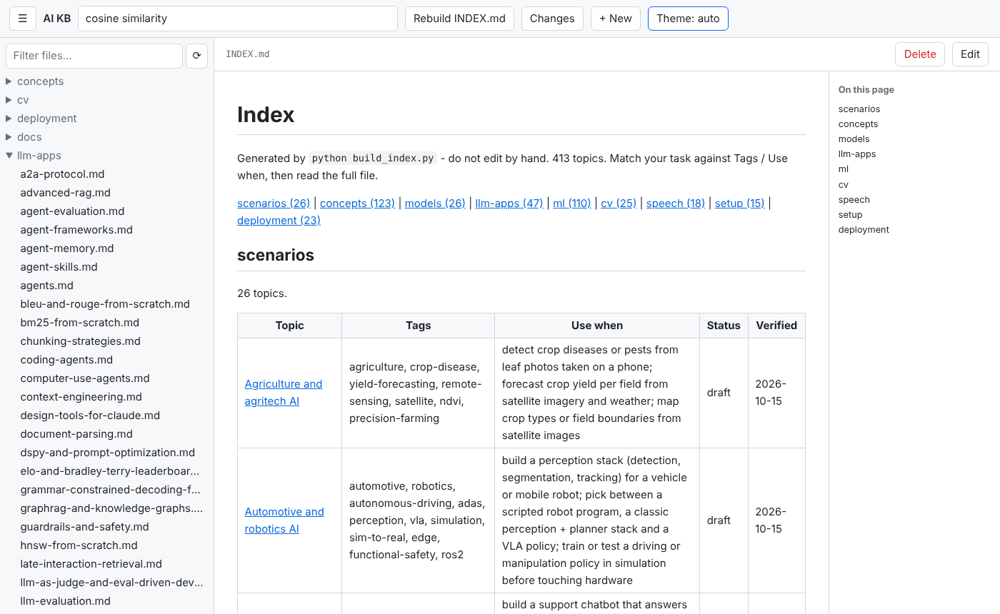

**INDEX.md** renders as one table per category (Topic, Tags, Use when,
Status, Verified); the topic links open the file in the app. Hide the sidebar
to give the table more room. **llms.txt** is shown as plain text.

Both glossary.md and learning-paths.md are checked by `build_index.py`: a
broken `[[link]]` in them fails the build. You can edit them in the app like
any other file. Do not edit INDEX.md or llms.txt: change the topic and press
[Rebuild INDEX.md](#rebuild-indexmd).

### Dark mode

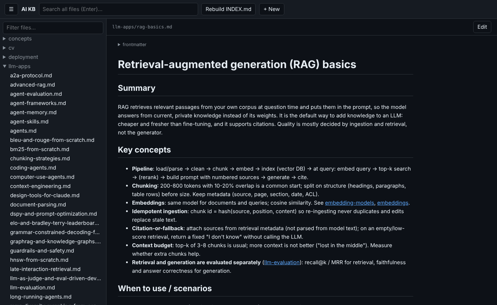

The app follows your operating system's light/dark setting
(`prefers-color-scheme`). There is no separate switch.

### Safety model

The app can write to your repo, so it is locked down to your own machine and
your own browser tab:

- **Local only.** It binds to `127.0.0.1`, so other machines cannot reach it.
- **Host check.** Every request must carry a `Host` of `localhost`,
  `127.0.0.1` or `::1`, otherwise it gets "403 forbidden host". This blocks
  DNS-rebinding attacks, where a web page you visit points its own domain name
  at 127.0.0.1.
- **Origin check.** A request with an `Origin` header must come from the same
  host and port, so another site open in your browser cannot post to the app.
- **Write token.** Saving, creating files and running actions need a random
  token that is generated each time the server starts and handed only to the
  app's own page. Restarting the server invalidates it; the next save shows
  "bad token (reload the page)", and reloading fixes it.
- **Paths stay inside the repo.** Absolute paths, `..`, hidden path parts,
  skipped folders, symlinks that resolve outside the repo and extensions not in
  the list are refused. Files over 2 MB cannot be opened or saved.
- **Images are read-only.** Images are served by a separate read-only route
  with the same path rules, only for PNG, JPEG, GIF and WebP files (checked by
  extension and file content), up to 10 MB. They cannot be opened in the
  editor or saved.
- **Fixed commands only.** The action buttons run only the commands listed in
  `config.json`; the page cannot send a command of its own.
- **Strict browser headers.** A Content-Security-Policy allows only the app's
  own script and styles, and responses are not cached.
- **No lost writes.** Atomic save plus [conflict detection](#conflict-detection).

It has no login. Anyone who can use your computer's browser while it runs can
edit the files, as they could with your editor.

### Settings (webapp/config.json)

```json
{"title": "AI KB", "port": 8773,
 "extensions": [".md", ".txt", ".csv", ".json", ".yml", ".yaml", ".toml", ".py", ".sh"],
 "skip_dirs": ["node_modules", "__pycache__", "venv", ".venv"],
 "readonly": [],
 "actions": {"Rebuild INDEX.md": ["python3", "build_index.py"]}}
```

- `title`: shown in the header and the browser tab.
- `port`: default port.
- `extensions`: which files are listed, searched and editable.
- `skip_dirs`: folders left out of the tree and search.
- `readonly`: paths or folder prefixes (for example `"INDEX.md"` or
  `"models/"`) that can be viewed but not saved or created. Such files show a
  🔒 in the tree and "(read-only)" next to the path. Empty in this repo.
- `actions`: one header button per entry; the value is the command, run in
  the repo root. Adding `"Rebuild (strict)": ["python3", "build_index.py",
  "--strict"]` would add a button for the CI-equivalent build.

Restart the server after changing the file.

### Tips, troubleshooting and limits

- **"403 forbidden host"**: open the app as `localhost` or `127.0.0.1`, not
  via your machine's LAN name or a tunnel.
- **"bad token (reload the page)"**: the server was restarted; reload the tab.
- **"Address already in use"**: another program uses 8773; start with
  `--port 8774`.
- **A new file does not show in the tree**: files created outside the app
  appear after a page reload.
- **Search finds nothing**: the query needs at least 2 characters and is
  matched as one phrase; try a single word.
- **Review before committing.** Edits go straight to your working tree. Run
  `git diff` and the checks in AGENTS.md before you commit.
- Limits: no delete, rename or move (use the shell or git); no git
  integration; no SVG or remote images; search results are not ranked; the Markdown
  renderer is simpler than GitHub's, so check unusual formatting on GitHub.

---

## Part 2: the read-only Django site

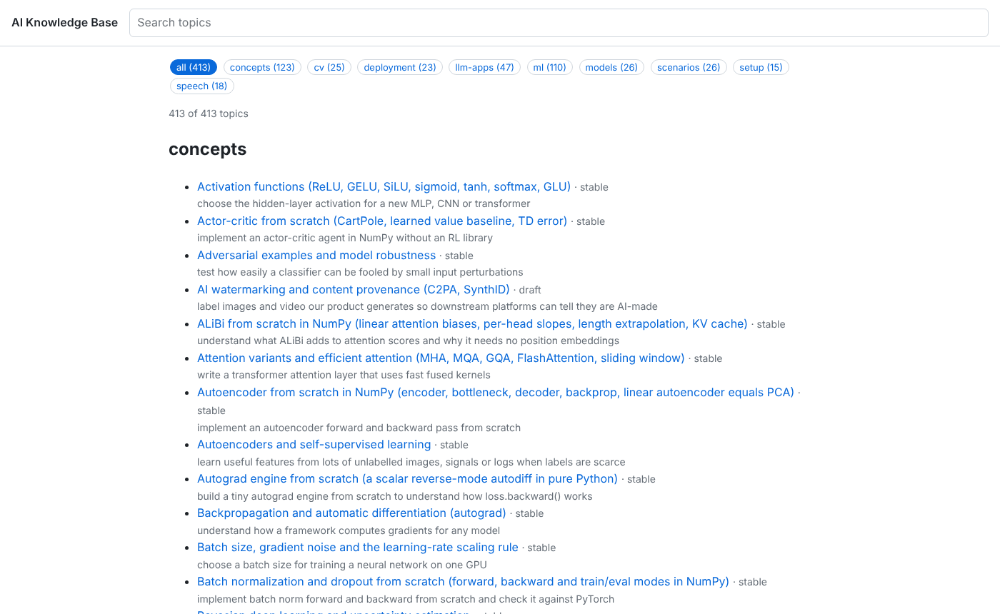

A small Django project (`manage.py`, `webapp/settings.py`, `webapp/urls.py`,
`webapp/views.py`, `webapp/templates/`) that shows the topics as a site:
titles instead of file names, category and tag filters, rendered pages with
working `[[links]]`, and a "Linked from" list. It also shows the glossary, learning
paths, INDEX.md and llms.txt. It cannot change any file.

### Start it

```bash
pip install -r requirements.txt               # django, markdown
python manage.py runserver 127.0.0.1:8001     # http://127.0.0.1:8001/
python manage.py test webapp                  # its tests (and the edit app's write tests)
```

Without an address `runserver` uses port 8000; any free port works.

Settings come from environment variables (`webapp/settings.py`):

| Variable | Default | Purpose |
|---|---|---|
| `DJANGO_DEBUG` | `1` | `0` turns off debug pages |
| `DJANGO_SECRET_KEY` | a fixed dev value | set a real one if you expose the site |
| `DJANGO_ALLOWED_HOSTS` | `localhost,127.0.0.1` | comma-separated host names it answers to |

There is no database and no migrations to run, and all CSS is inline in
`base.html`, so there are no static files to collect.

### Topic list

**What it does.** The home page (`/`) lists every topic grouped by category
(folder), alphabetically. Each entry shows the topic's `title` from its
frontmatter, its `status` (draft/stable/needs-review) and its first
`use_cases` line, so you can tell what a topic is for without opening it. A
line above the list says how many topics are shown out of the total.

**When.** Scanning what the KB covers, or finding a topic by what you want to
do (the use-case line) rather than by its file name.

**Why.** INDEX.md holds the same data, but as one long table; this view is
grouped, shorter per entry, and filterable.

### Search

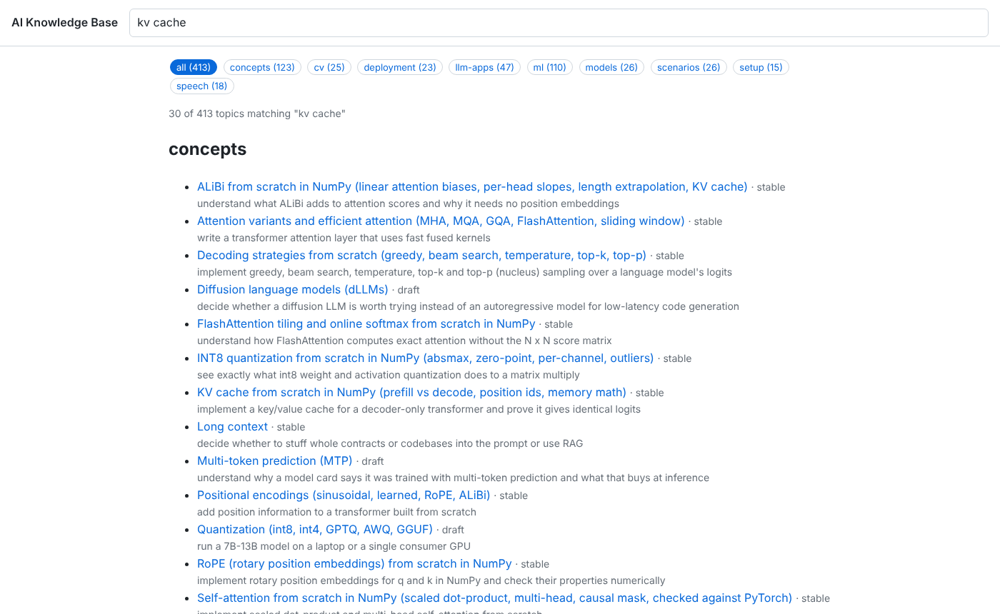

**What it does.** The header box searches the full text of every topic,
frontmatter included. Every word you type must appear somewhere in the topic
(in any order, case-insensitive, partial words count): `kv cache` matches
topics containing both "kv" and "cache". Results keep the grouped list
format.

**How to use it.** Type in **Search topics** and press Enter. The query is in
the URL (`/?q=kv+cache`), so a search can be bookmarked or shared.

**When.** "Which topics deal with X?" when you want topics, not lines (the
edit app's search shows lines).

**Why.** Word-based matching finds topics that mention all your terms even
when they are not next to each other.

### Category filter

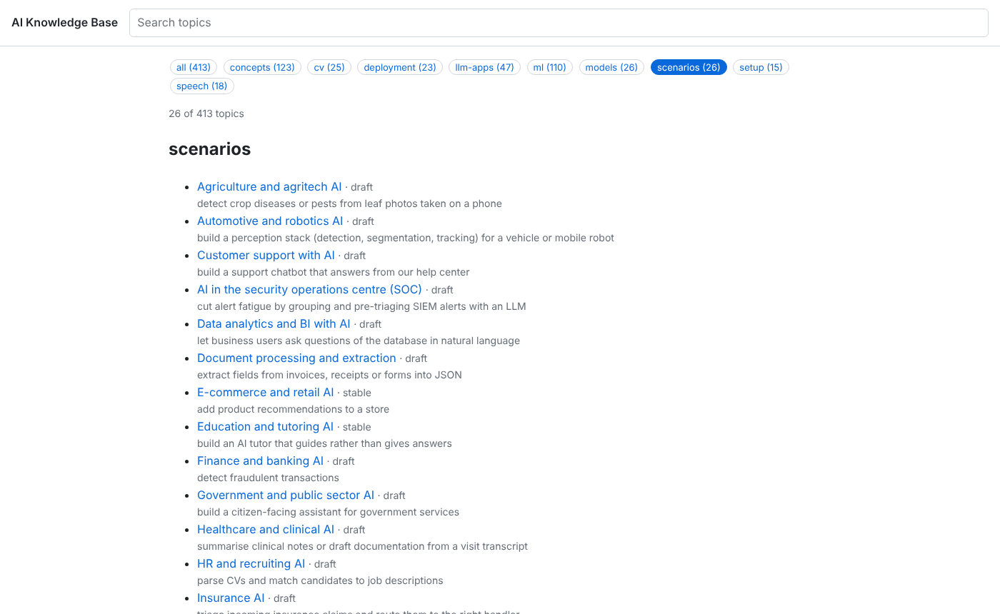

**What it does.** The chips under the header (**all (413)**, **concepts
(123)**, ...) limit the list to one category. The counts are each category's
total size. The selected chip is highlighted.

**How to use it.** Click a chip; click **all** to remove the filter. A category
filter combines with a search: search first, then click a chip, and the query
is kept (`/?category=models&q=pricing`).

**When.** Browse only `scenarios/` (problem-to-approach guides) or only
`models/`.

### Topic page

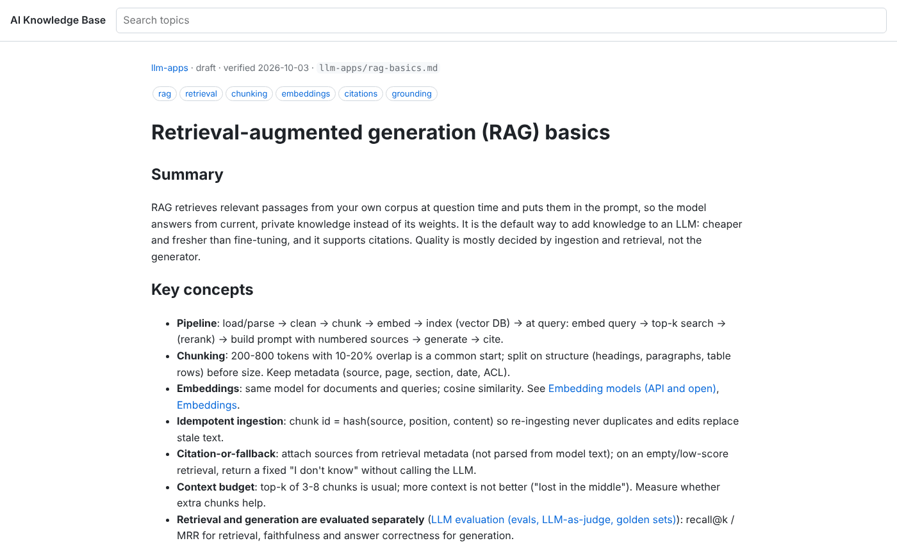

**What it does.** `/t/<file-name>/` (for example `/t/rag-basics/`) shows one
topic:

- a line with the category (a link to that category's list), `status`,
  `last_verified` date and the file path;
- the topic's `tags` as chips;
- the body rendered with Python-Markdown (fenced code, tables, lists); the
  frontmatter itself is not shown as text.

**When.** Reading a topic. The verified date on top tells you how fresh its
volatile facts (model names, prices, limits) are.

### Tag filter

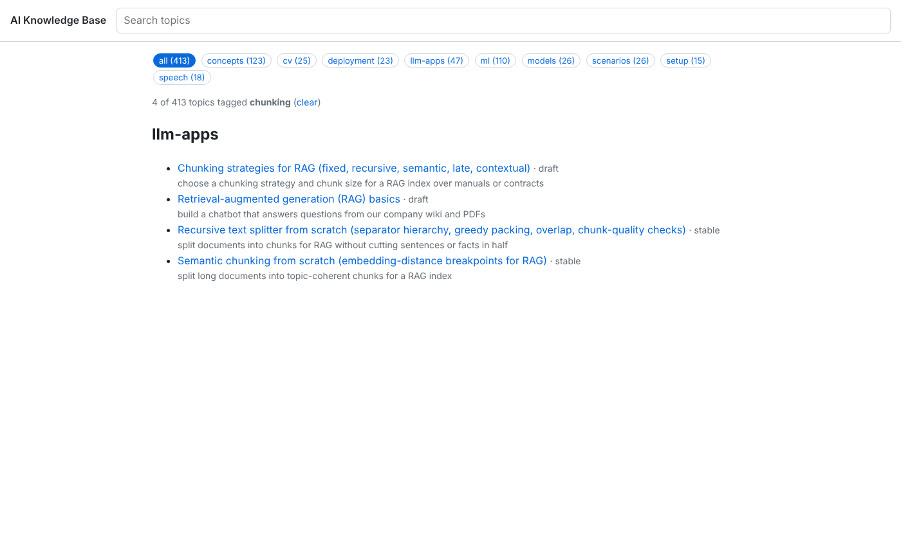

**What it does.** Clicking a tag chip on a topic page lists every topic with
that tag (`/?tag=chunking`). The line above the list says "tagged
**chunking** (clear)"; **clear** removes the tag filter.

**When.** Finding siblings of a topic: everything else tagged `rag`,
`fine-tuning`, `from-scratch`, and so on.

**Why.** Tags cut across folders, so they find related topics that live in
different categories.

Note: clicking a category chip while a tag filter is on drops the tag filter.

### Links between topics

![Related section on the site: [[links]] shown with the target topic's title](screenshots/django-links.png)

**What it does.**

- `[[name]]`, `[[name|label]]` and `[[name#section]]` become links to
  `/t/name/`. Without a label the link text is the target's title, so you see
  "Chunking strategies for RAG (...)" instead of `chunking-strategies`.
- A `[[name]]` that matches no topic is shown in red with a strikethrough.
- Relative Markdown links to another topic (`[x](../concepts/embeddings.md#key-concepts)`)
  are rewritten to the site page, keeping the `#section`.
- Links to `glossary.md`, `learning-paths.md`, `INDEX.md` and `llms.txt` go to
  `/glossary/`, `/learning-paths/`, `/index/` and `/llms.txt`.
- Text inside code blocks and inline code is left alone, so `[[1, 2]]` in a
  Python snippet stays a list.

Links match on the file name only (`rag-basics`), so two topics with the same
file name in different folders would clash; the build keeps names unique.

### Sources and backlinks

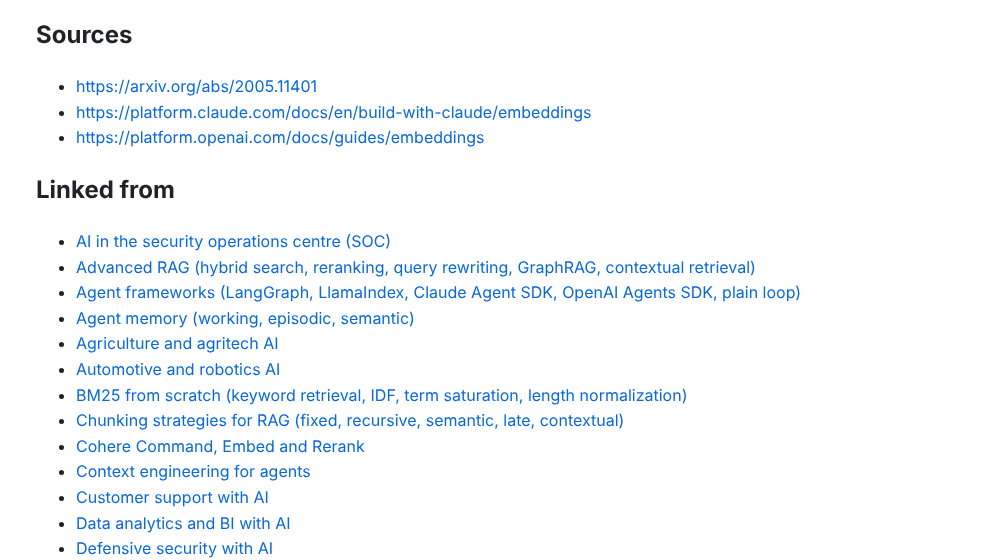

**What it does.** Below the body:

- **Sources** lists the URLs from the topic's `sources` frontmatter as links.
- **Linked from** lists every topic whose text contains `[[this-topic]]`,
  sorted by title. Links written with a label or section
  (`[[rag-basics|RAG]]`, `[[rag-basics#gotchas]]`) and plain Markdown links
  are not counted.

**When.** Backlinks show where a topic is used, which helps you judge its
reach before you change it, and lead you to the scenario and overview pages
that point at it. Sources tell you where to re-check a fact.

**Why.** Neither GitHub nor the edit app can show "what links here".

### Glossary, learning paths, INDEX.md and llms.txt

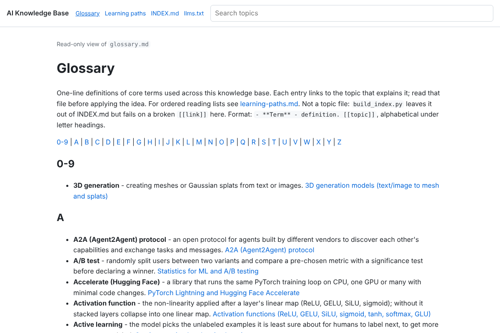

**What it does.** The header links to four read-only pages besides the topics:
**Glossary** (`/glossary/`, glossary.md), **Learning paths** (`/learning-paths/`,
learning-paths.md), **INDEX.md** (`/index/`) and **llms.txt** (`/llms.txt`, served
as plain text). The three Markdown files are rendered like topics: their `[[links]]`
and relative links (INDEX.md's `scenarios/agriculture.md` rows) open the topic pages.
A topic's Markdown link to one of these files (`[terms](../glossary.md#a)`) opens
the matching page, keeping the `#section`.

**When.** Looking up a term and jumping to the topic that explains it, or following
a reading path step by step.

### What the site does not show

The site serves topics plus only those four files, from a fixed list. Other
repo-root files (README.md, AGENTS.md, ROADMAP.md, `_template.md`) have no page,
and a link to one of them leads to a "Page not found". Read those in the
[edit app](#glossary-learning-paths-indexmd-and-llmstxt) or on GitHub.

### Tips, troubleshooting and limits

- **Edits show up on refresh.** Every request re-reads the files, so you can
  edit in the edit app or your editor and reload the site page.
- **"Bad Request (400)"**: you opened the site under a host name that is not in
  `DJANGO_ALLOWED_HOSTS` (for example `localhost` vs a LAN IP). Add it to the
  variable.
- **Port in use**: other tools may use 8000; pass another port such as
  `127.0.0.1:8001`.
- **`ModuleNotFoundError: No module named 'django'` or `'markdown'`**: run
  `pip install -r requirements.txt` in the Python you start it with.
- Limits: read-only; no ranking of search results; it re-reads all 400+ files
  on each request, which is fine locally but not tuned for heavy traffic;
  `runserver` is Django's development server, not a production server.
